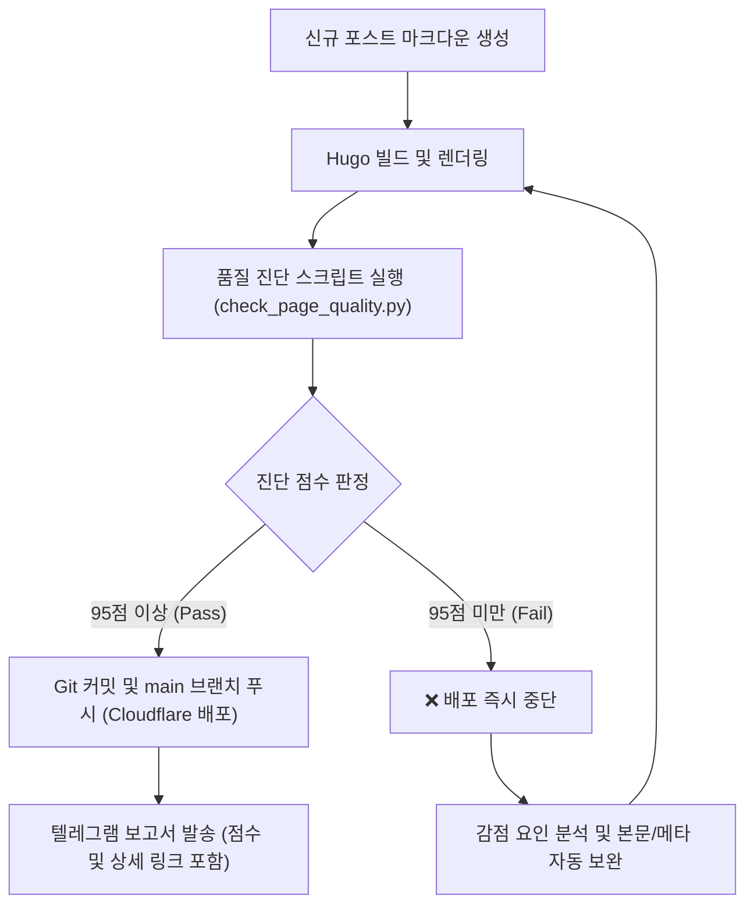

# 🏆 [이지부고 블로그] 포스팅 품질 진단 기준 및 재작업 규정 (QA Standards)

본 문서는 이지부고 블로그(`blog.easybugo.com`)의 모든 신규 및 정기 포스팅에 적용되는 **품질 진단 평가 기준과 발행 통과 조건**을 정의합니다.

> **[핵심 규정]**  
> 페이지 개설 및 빌드 완료 후 자동 품질 진단 테스트를 필수로 실행하며, **진단 점수가 95점 미만일 경우 발행 실패(Fail)로 간주하고 즉시 배포를 중단한 후 결함을 보완하여 재작업**합니다.

---

## 1. 100점 만점 평가 배점표

| 평가 영역 | 세부 검증 항목 | 배점 | 감점/실패 기준 |
|---|---|---|---|
| **1. HTTP & 메타 기본 (25점)** | • HTTP Status 200 OK (또는 HTML 빌드 무결성) • Canonical URL 정합성 (영구링크와 일치) • Charset UTF-8 및 Viewport 반응형 메타 | **10점** **10점** **5점** | • 404/500 또는 빌드 누락: **-25점 (즉시 탈락)** • Canonical 불일치 또는 누락: -10점 • 뷰포트/문자셋 누락: -5점 |
| **2. SEO 최적화 (25점)** | • Title 태그 (15~55자, 브랜드/핵심키워드 포함) • Meta Description (60~160자, 키워드 포함) • Open Graph 태그 (og:title, og:description, og:url) | **10점** **10점** **5점** | • 타이틀 너무 짧거나 긺: -5점 / 누락: -10점 • 디스크립션 60자 미만: -5점 / 누락: -10점 • OG 태그 1개 이상 누락: -5점 |
| **3. 콘텐츠 & AEO 구조 (30점)** | • 본문 실질 텍스트 분량 (1,200자 이상) • 헤딩 태그 계층 (H1 1개, H2 2개 이상 체계화) • AEO 구조화 데이터 (FAQ Q&A 2개 이상 포함) | **10점** **10점** **10점** | • 800자 미만: -10점 / 1,200자 미만: -5점 • H2 태그 1개 이하: -5점 / H1 누락: -10점 • FAQ 섹션 누락: -10점 |
| **4. 전환 & 무결성 (20점)** | • 이지부고 메인 CTA 링크(`https://easybugo.com/`) • 조문객/상주 실전 서식 템플릿 포함 여부 • 미처리 시스템 플레이스홀더(TODO 등) 유무 | **10점** **5점** **5점** | • 이지부고 공식 CTA 누락: -10점 • 복사 가능한 서식 템플릿 누락: -5점 • 개발용 임시 문자열 잔존: -5점 |

---

## 2. 합격/실패 판정 및 작업 프로세스

### [실패 시 대응 매뉴얼 (95점 미만)]
1. 배포 파이프라인(`git push`)을 즉시 차단합니다.
2. 진단 리포트에서 감점된 항목(예: 메타 디스크립션 길이 부족, FAQ 누락, 본문 분량 부족 등)을 확인합니다.
3. 해당 항목을 보강하는 수정 작업을 수행한 후 재빌드 및 재검사를 진행합니다.
4. 95점 이상을 획득할 때까지 이 과정을 반복하며, 모든 통과 이력은 로그에 기록합니다.
